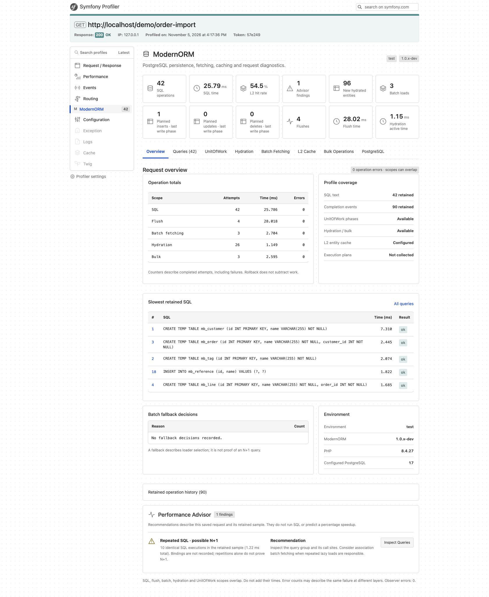

# ModernORMBundle

**Find expensive ORM work in Symfony. Follow it from the Profiler to Grafana.**

ModernORMBundle brings [ModernORM](https://github.com/andreybolonin/modernorm), the PostgreSQL-first ORM for PHP 8.4+, into Symfony with a Performance Advisor, request-level diagnostics and OpenTelemetry metrics.

[Documentation](docs/README.md) · [Monitoring demo](examples/observability/README.md) · [CI](https://github.com/andreybolonin/modernormbundle/actions/workflows/tests.yml) · [Changelog](CHANGELOG.md)



## What you get

| Feature | What it helps you do |
| --- | --- |
| **[Performance Advisor](docs/profiler.md#performance-advisor)** | Investigate repeated SQL, slow queries, frequent flushes, costly hydration and one-item batches using measured evidence and links to the relevant panel. |
| **[Symfony Profiler](docs/profiler.md)** | Explore eight saved-profile tabs: Overview, Queries, UnitOfWork, Hydration, Batch Fetching, L2 Cache, Bulk Operations and PostgreSQL. |
| **[OpenTelemetry / OTLP export](docs/observability.md)** | Export SQL/flush/batch/bulk timings, hydration and global L2 activity through the application's MeterProvider and OTLP exporter. |
| **[Grafana dashboard + VictoriaMetrics](examples/observability/README.md)** | Start a runnable Collector → VictoriaMetrics → Grafana example with eleven provisioned panels for rates, latency, batching and cache reuse. |
| **[Batch and L2 visibility](docs/profiler.md)** | See association groups, selected batch sizes, fallback decisions and entity-cache hits, misses, puts and invalidations. |
| **[Symfony services and workers](docs/getting-started.md)** | Inject the EntityManager, DBAL connection and Statistics; reset ORM state between requests and Messenger jobs. |
| **[Migrations](docs/migrations.md) and [fixtures](docs/fixtures.md)** | Use dedicated console commands, schema ownership filters, constructor-injected fixtures, groups and references. |

The monitoring stack is opt-in and ships as a runnable prototype. [Explore the Profiler gallery and measurement notes →](docs/profiler.md#profiler-gallery)

## Quick start

Requires **PHP 8.4+, PostgreSQL and Symfony 7.4 or 8.x**. Add TwigBundle and WebProfilerBundle for the optional debug UI.

```sh
composer require 'andreybolonin/modernorm:^0.1.0-beta.3' 'andreybolonin/modernorm-bundle:^0.1.0-beta.3'
```

Register the bundle in `config/bundles.php`:

```php
ModernORM\Bundle\ModernORMBundle::class => ['all' => true],
```

Configure your connection and entity directory:

```yaml
# config/packages/modernorm.yaml
modernorm:
    url: '%env(resolve:DATABASE_URL)%'
    mapping_paths:
        - '%kernel.project_dir%/src/Entity'
    batch_size: 32
    profiler:
        collect_sql: '%kernel.debug%'
```

Inject `ModernORM\EntityManagerInterface` into your services. With Symfony's WebProfiler enabled and its standard routes imported, the ModernORM panel is registered automatically.

[Full installation, cache configuration and service aliases →](docs/getting-started.md)

## Take the metrics to Grafana

The included example connects real ORM workloads to a local monitoring stack:

```text
ModernORM → OpenTelemetry PHP SDK → OTLP/HTTP → Collector → VictoriaMetrics → Grafana
```

Follow SQL and bulk activity, latency histograms, hydration, batch sizes and L2 hit ratio across HTTP processes and workers. The Collector also exposes a Prometheus-compatible endpoint.

[Run the monitoring stack →](examples/observability/README.md) · [Adapters and worker lifecycle →](docs/observability.md)

## Go deeper

[Profiler and Advisor settings](docs/profiler.md) · [Migrations](docs/migrations.md) · [Fixtures](docs/fixtures.md) · [Tests and compatibility](docs/testing.md) · [All documentation](docs/README.md)

MIT licensed. [Contributions](CONTRIBUTING.md) and [security reports](SECURITY.md) are welcome.
