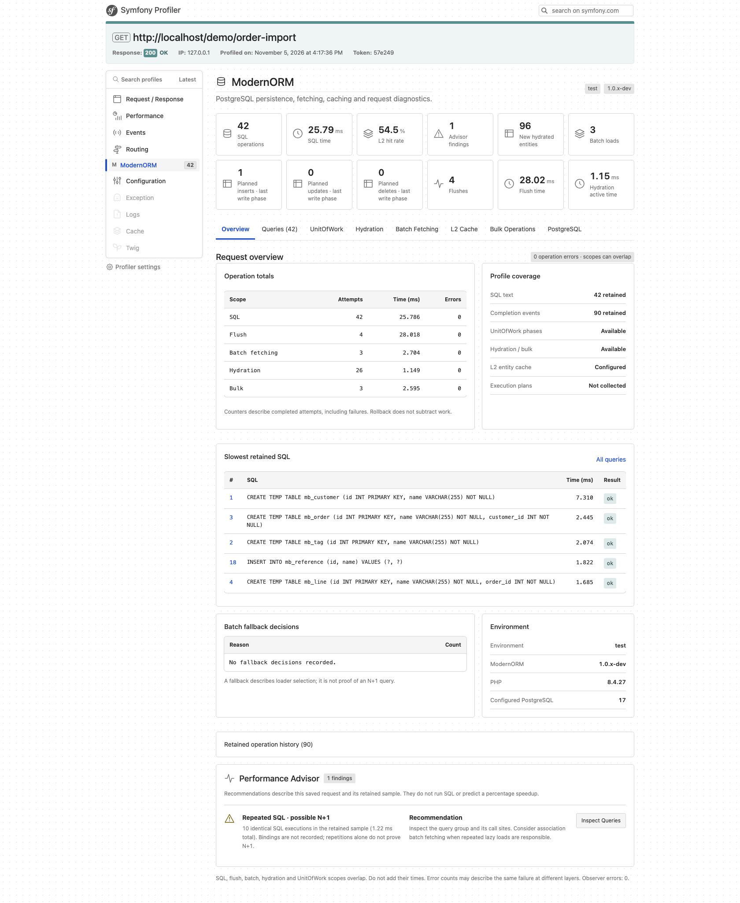
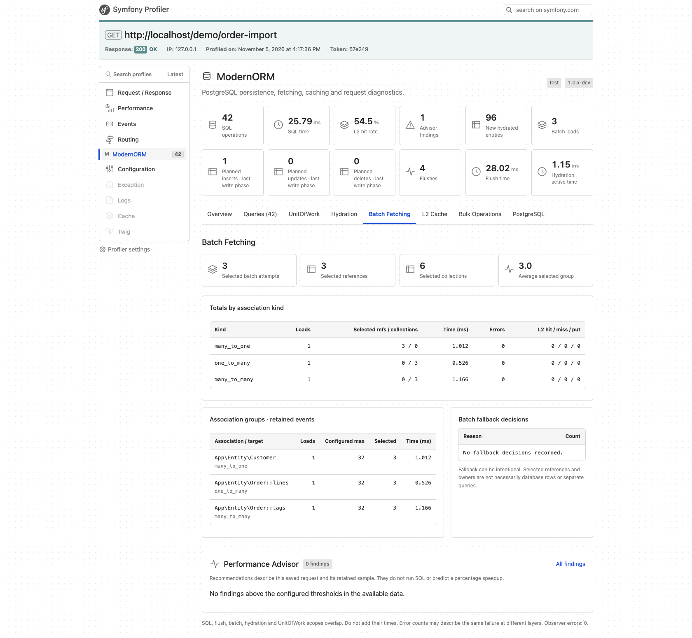
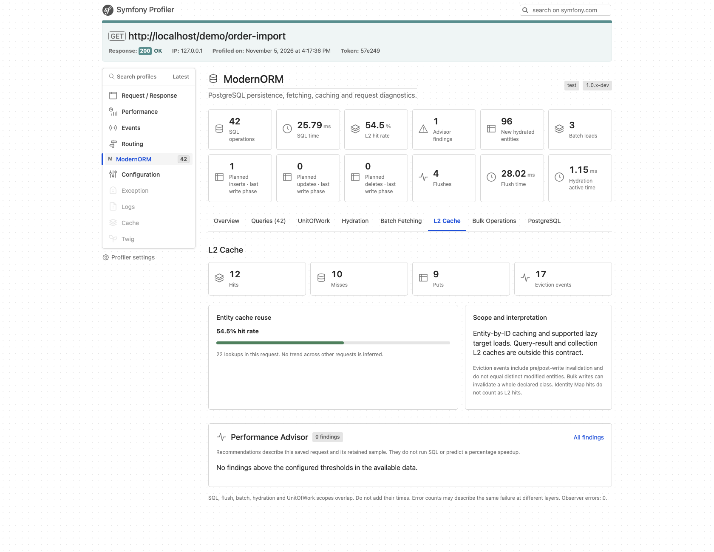
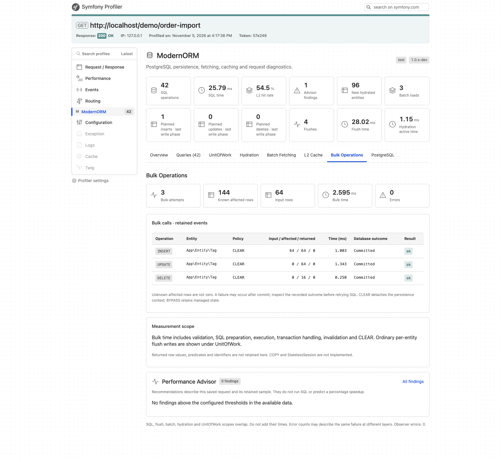
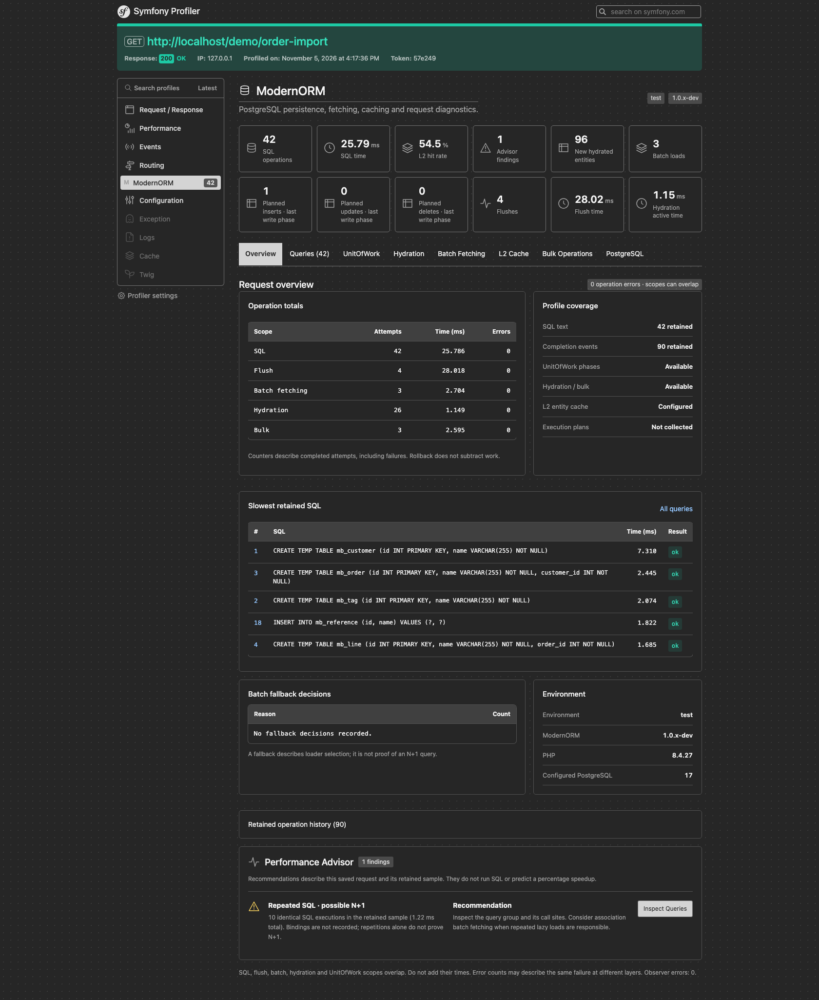

# Symfony Profiler and Performance Advisor

[Documentation](README.md) · [Setup](getting-started.md) · [Monitoring](observability.md)

The toolbar shows SQL count/time, flush and batch counts, L2 hits/misses and Advisor findings. Eight tabs provide a request dashboard, query history, UnitOfWork phases, hydration, batch groups, entity L2 counters, bulk outcomes and PostgreSQL context. Completion history is bounded and stored with the profile.

History is recorded only during HTTP requests while Symfony's Profiler is enabled. The history limit does not limit aggregate counters. Core operation events contain no SQL text, bindings, identifiers or exception messages. SQL timing excludes fetching/hydration; batch and flush timings overlap SQL time. Bulk SQL is included in SQL totals. When the core exposes extended operation events, separate bulk, hydration and UnitOfWork metrics are displayed. Older saved profiles display explicit unavailable states for missing metrics. UnitOfWork write counts describe scheduled work, not executed DML totals.

Enable `modernorm.profiler.collect_sql: true` for a query list containing SQL text, duration, driver method and error SQLSTATE. This is a separate DBAL middleware in the bundle; the core Statistics API remains unchanged. Collection requires an active profiled HTTP request and works independently of aggregate Statistics being enabled. With `collect_sql: false`, the SQL middleware is not installed.

SQL history is bounded separately by `max_queries` and `max_sql_length`. Entries beyond the limit are counted but not retained; aggregate counters remain complete. Repeated SQL groups use a SHA-256 fingerprint of the complete, exact query text, so queries with different bindings group together and different long queries sharing a truncated prefix stay distinct. Counts cover retained entries only; this is an aid for investigating N+1, not automatic proof of it.

Bindings and exception messages are never stored by this SQL collector. Literal values embedded directly in SQL remain visible. Prepared statements keep their SQL template for later execution; no bound values are retained by the wrapper. Successful preparation alone is not a query; failed preparation is one failed entry. Transaction driver API calls are excluded. Query timing excludes result fetching and hydration.

Statistics default to `kernel.debug`. In production they can be enabled independently of the Profiler. With statistics disabled, no operation events are produced. If L2 is configured its lightweight cache counters remain available independently.

## Performance Advisor

Find repeated SQL, slow executions, repeated flushes, costly hydration, large persistence contexts, single-item batches and low L2 reuse. Each finding includes measured evidence, a recommendation and a link to the relevant Profiler tab. Findings describe the saved request; they do not execute EXPLAIN or claim a proven N+1.

The Performance Advisor orders findings by severity, then measured duration (descending), with a stable ID tie-breaker. Untimed findings follow timed findings of the same severity. Timings may overlap and are not an estimate of recoverable request time. The configured `max_findings` limit applies after ranking.

Hydration rules use aggregate counters even when operation history is limited. `modernorm.profiler.advisor.hydration_ms` defaults to 50 ms of active hydration time; `hydrated_entities_threshold` defaults to 1000 newly created entity instances. Counts do not measure peak memory or distinct database entities. Older cores without hydration metrics skip these rules. Omitted SQL entries are disclosed in query evidence and in the Advisor overview, including when no SQL finding reaches a threshold. Query ranking covers only retained entries, not the slowest executions of the entire request.

Additional Advisor thresholds under `modernorm.profiler.advisor`:

- `flush_count_threshold` (default 5): successful flush attempts per request. Evidence includes total attempts, failures and aggregate duration, independently of retained events. It does not establish a flush inside a loop or redundant writes; changing flush boundaries can change business semantics.
- `batch_singleton_threshold` (default 5): successful retained batches that each selected exactly one reference or collection despite a configured size above one, grouped by association kind, target class, association and configured size. Review loading/access order before increasing batchSize. Selected items are not rows or SQL counts.
- `batch_fallback_threshold` (default 5): repeated `size_one` fallback decisions, now attributed to individual retained association/target groups where possible. When no group reaches the threshold, the existing aggregate hint remains available. A concrete finding replaces the duplicate aggregate hint.

Association hints use saved operation events. Missing source associations are displayed as target classes; ManyToOne events currently do not identify the source association. Dropped events are disclosed, counts are never extrapolated, and absence of a finding does not establish absence of a loading issue. Failed batches, multi-item batches and unrelated fallback reasons do not count toward the one-item rule. Rules do not execute SQL or claim proven N+1.

### Advisor configuration

All settings are under `modernorm.profiler.advisor`:

| Setting | Default | Controls |
| --- | --- | --- |
| `enabled` | `true` | Collect Advisor findings when Statistics is enabled |
| `max_findings` | `10` | Findings retained after ranking |
| `repeated_query_threshold` | `5` | Repetitions of the same complete SQL text in retained history |
| `slow_query_ms` | `10` | Individual successful SQL duration |
| `managed_entities_threshold` | `1000` | Managed entities observed at UnitOfWork boundaries |
| `change_sets_ms` | `10` | Aggregate change-set calculation time |
| `hydration_ms` | `50` | Aggregate active hydration time |
| `hydrated_entities_threshold` | `1000` | New instances created during hydration |
| `flush_count_threshold` | `5` | Successful flush attempts per request |
| `batch_singleton_threshold` | `5` | One-item batches in a retained association/target group |
| `batch_fallback_threshold` | `5` | Repeated `size_one` fallback decisions |
| `l2_min_lookups` | `20` | Minimum lookups before evaluating L2 reuse |
| `l2_min_hit_rate` | `0.5` | L2 hit-rate threshold, expressed as a fraction |

## Profiler gallery

Inspect an entire request from one dashboard, then follow the data into Queries, UnitOfWork, Hydration, Batch Fetching, L2 Cache, Bulk Operations and PostgreSQL tabs. The Performance Advisor provides evidence and links to the relevant panel.

### Association batch fetching

See ManyToOne, OneToMany and ManyToMany batches, selected group sizes and association-level activity.

### Entity L2 cache

Inspect hits, misses, puts and invalidations alongside this request's cache hit rate.

### PostgreSQL bulk writes

Review bulk INSERT, UPDATE and DELETE calls, affected rows, persistence-context policies and recorded database outcomes.

Dark theme and additional panels

[Queries](screenshots/symfony-profiler/queries.png) · [UnitOfWork](screenshots/symfony-profiler/unitofwork.png) · [Hydration](screenshots/symfony-profiler/hydration.png) · [PostgreSQL](screenshots/symfony-profiler/postgresql.png)

Screenshots show the local implementation running a PostgreSQL demonstration workload with real bulk operations and deliberately repeated reference lookups. Figures are illustrative, not benchmark results. Extended bulk, hydration and UnitOfWork metrics require a core version exposing the corresponding operation events; older saved profiles show unavailable metrics explicitly when fields are absent. EXPLAIN plans and buffer statistics are not collected. See the [capture notes](screenshots/symfony-profiler/README.md).
